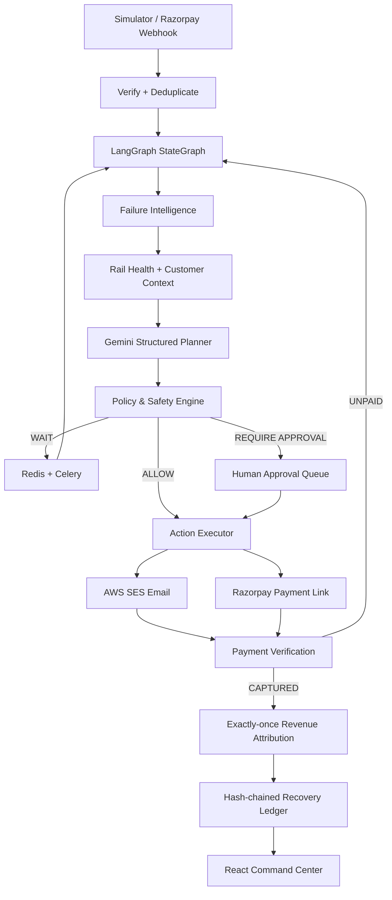

# ReviveAI — Autonomous Revenue Recovery

**Recover more. Contact less. Prove every rupee.**

ReviveAI is a bounded, event-driven revenue recovery platform for failed payments. It combines deterministic payment intelligence, LangGraph orchestration, Gemini structured planning, human approval, asynchronous recovery scheduling, Razorpay Test Mode, AWS SES email, and a tamper-evident recovery ledger.

> **Benchmark disclaimer:** all benchmark numbers are synthetic deterministic simulation results, not merchant production results.

## Verified synthetic benchmark

Seed `2026`, 1,000 paired cases:

- Revenue at risk: **₹33.865L**
- Organic recovery: **₹6.378L**
- Naive dunning: **₹9.487L**
- ReviveAI: **₹14.671L**
- Incremental vs naive: **+₹5.183L**
- Recovery uplift: **+54.6%**
- Customer contacts avoided: **293**

## Architecture



## Product surfaces

- **Command Center** — revenue at risk, recovered revenue, recovery rate, contacts, rail health.
- **Recovery Cases** — customer journey, LangGraph trace, Gemini decision, communication preview, promise-to-pay, payment link, audit timeline.
- **Rail Incidents** — correlated provider degradation and suppressed outreach.
- **Approvals** — HITL queue for high-value/exception cases; approve/reject is audited.
- **Batch Lab** — reproducible Organic vs Naive vs ReviveAI evaluation.
- **Recovery Ledger** — global tamper-evident audit stream with integrity verification.

## Safety model

Gemini can recommend **how** to recover. It cannot change amount/currency, bypass contact caps, charge a customer, or override approval policy. Deterministic code decides whether an action is allowed. Razorpay/payment truth decides whether money was recovered.

Key controls: webhook HMAC verification, idempotent event ingestion, one active link per case, max contact/recheck limits, quiet hours, high-value HITL, opt-out/dispute hooks, exactly-once attribution, JWT/RBAC, and hash-chained audit events.

## Run locally

```bash
cp .env.example .env
docker compose up -d --build
docker compose ps
```

Open:
- UI: `http://localhost:5173`
- API docs: `http://localhost:8000/docs`

Local login: `admin@revive.local` / `ChangeMe123!` (development only).

### Safe demo mode

```env
AI_PROVIDER=deterministic
MESSAGING_PROVIDER=simulated
RAZORPAY_USE_API=false
```

### Gemini

```env
AI_PROVIDER=gemini
GEMINI_API_KEY=...
GEMINI_MODEL=gemini-2.5-flash
```

### AWS SES

Verify the sender identity in SES and use least-privilege IAM credentials:

```env
MESSAGING_PROVIDER=ses
AWS_REGION=ap-south-1
AWS_ACCESS_KEY_ID=...
AWS_SECRET_ACCESS_KEY=...
SES_FROM_EMAIL=verified@example.com
```

The 1,000-case benchmark never sends real email; keep `MESSAGING_PROVIDER=simulated` for evaluation.

### Razorpay Test Mode

```env
RAZORPAY_USE_API=true
RAZORPAY_KEY_ID=rzp_test_...
RAZORPAY_KEY_SECRET=...
RAZORPAY_WEBHOOK_SECRET=...
```

Point Razorpay Test Mode webhooks at `/api/v1/webhooks/razorpay`. Never use live keys for the buildathon demo.

## Benchmark

```bash
docker compose exec api python -m app.cli benchmark --count 1000 --seed 2026
```

Same seed => same result. The simulator uses explicit propensities and communication costs so claims are reproducible and clearly separated from real merchant outcomes.

## Tests

```bash
docker compose exec api python -m unittest discover -s tests -v
cd e2e && npm install && npx playwright install chromium && npm test
```

## Demo story

1. Run Judge Demo.
2. Open a systemic case: ReviveAI waits and suppresses unnecessary outreach.
3. Open a customer-actionable case: inspect LangGraph → Gemini → Policy → Hinglish email/payment link.
4. Open Approvals: demonstrate high-value HITL.
5. Open Batch Lab: show +54.6% synthetic uplift and 293 avoided contacts.
6. Open Recovery Ledger: verify the audit chain.
7. With Razorpay Test Mode enabled, complete one payment and show exactly-once recovered revenue + automatic stopping.

## Tech stack

React, TypeScript, Vite, Recharts, FastAPI, Pydantic, LangGraph, Gemini API, PostgreSQL, SQLAlchemy, Alembic, Redis, Celery, Razorpay Test Mode, AWS SES, JWT/RBAC, Docker Compose, Playwright, GitHub Actions.

## Production notes

Use managed PostgreSQL/Redis, workload IAM roles instead of long-lived AWS keys, secret management, HTTPS-only cookies/token strategy, rate limiting, PII redaction, provider delivery/bounce events, alerting, and merchant-configurable policies before production use.
