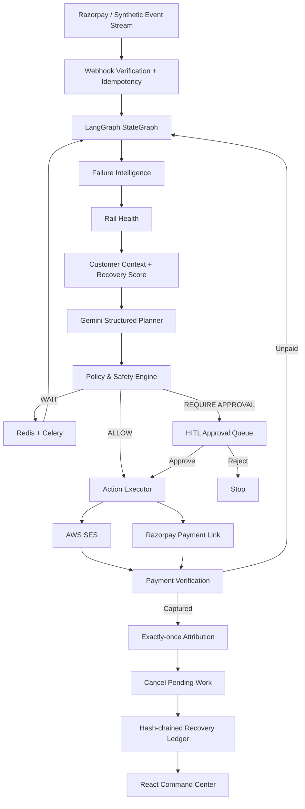

# Final architecture

## Trust boundary
The LLM never receives authority to mutate amount, currency, merchant identity, contact caps, approval thresholds or payment state. Structured plans are recommendations; deterministic policy and payment-provider truth remain authoritative.
