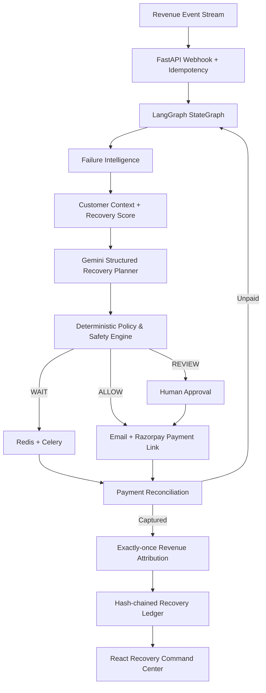

# ReviveAI final architecture

## Safety boundary
Gemini recommends recovery strategy and language. Deterministic code owns amount, currency, payment status, contact caps, approval thresholds, idempotency, execution, stopping and attribution.

## Adapters
- Payment: simulator or Razorpay Test Mode.
- Messaging: simulated email or SMTP email.
- AI: deterministic fallback or Gemini structured output.
